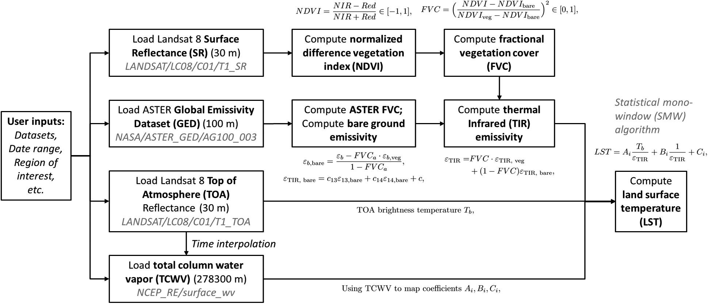
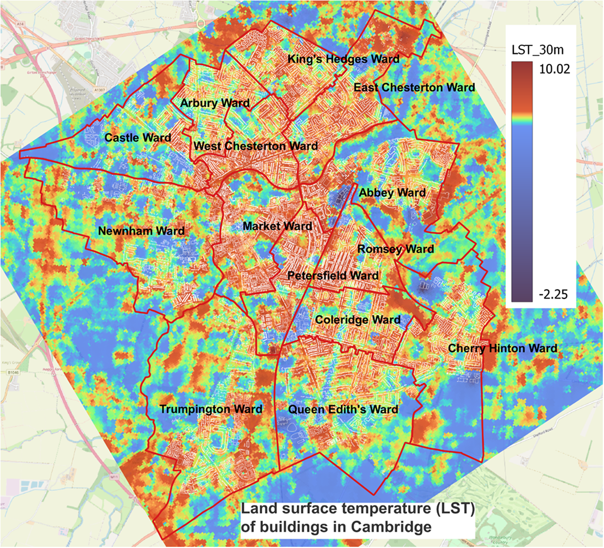

# gee-maps-cam

Google Earth Engine workflows for energy mapping of existing building stock using Energy Performance Certificates (EPCs), satellite thermal imagery, and drone thermal infrared data.

---

## Overview

Buildings account for a significant proportion of energy consumption and carbon emissions. This project develops a data-driven workflow to:

- Generate building archetypes using EPC datasets.
- Analyse energy consumption and retrofit potential of existing buildings.
- Derive land surface temperature (LST) from Landsat imagery.
- Process drone-based thermal infrared imagery.
- Detect thermal anomalies using machine learning.
- Support evidence-based retrofit prioritisation and urban energy planning.

The methodology was demonstrated using 1,725 buildings across Cambridge, UK.

---

## Key Features

- EPC-based building energy analysis
- Building archetype development
- Landsat-derived land surface temperature (LST) mapping
- Drone thermal infrared image analysis
- Thermal anomaly detection using Gaussian Mixture Models (GMM)
- Building retrofit potential assessment



*Fig. 1. Workflow for estimating land surface temperature (LST) from Landsat 8 imagery using the Statistical Mono-Window algorithm, combining vegetation cover, emissivity, brightness temperature, and atmospheric water vapour data.*

---

## Main Findings from the Study

The Cambridge case study found that:

- Buildings constructed after 1980 are substantially more energy efficient than older buildings.
- Older buildings exhibit significantly greater retrofit potential.
- Heating accounts for the majority of building energy use.
- Thermal anomalies can be reliably detected only when thermal imagery resolution is approximately 1 m/pixel or better.
- Thermal imagery with 1–6 m/pixel resolution can identify building-scale hot areas.
- Thermal imagery with resolutions coarser than 6 m/pixel is more suitable for urban-scale heat mapping than individual building diagnostics.



*Fig. 2. Satellite-derived land surface temperature (LST) of Cambridge.*

---

## Installation

Clone the repository:

```bash
git clone https://github.com/easy-research-lab/gee-maps-cam.git
cd gee-maps-cam
```

Install dependencies:

```bash
pip install -r requirements.txt
```

or

```bash
conda env create -f environment.yml
conda activate gee
```

## Google Earth Engine

Create a Google Earth Engine account:

https://earthengine.google.com/

Authenticate:

```bash
earthengine authenticate
```

## Usage

Start Jupyter Lab:

```bash
jupyter lab
```

Open and run the notebooks in the repository.

## Data Sources

- Google Earth Engine
- Landsat imagery
- UK EPC database
- Building footprint data
- Drone thermal infrared imagery

## Citation

```bibtex
@article{he2024energymapping,
  title={Energy mapping of existing building stock in Cambridge using energy performance certificates and thermal infrared imagery},
  author={Yinglong He, Jiayu Pan, Ramit Debnath, Ronita Bardhan, Luke Cullen, Marco Gomez Jenkins, Erik Mackie, George Hawker, and Ian Parry.},
  journal={Environmental Data Science},
  volume={3},
  pages={e44},
  year={2024},
  doi={10.1017/eds.2024.26}
}
```

## License

See the LICENSE file for details.

